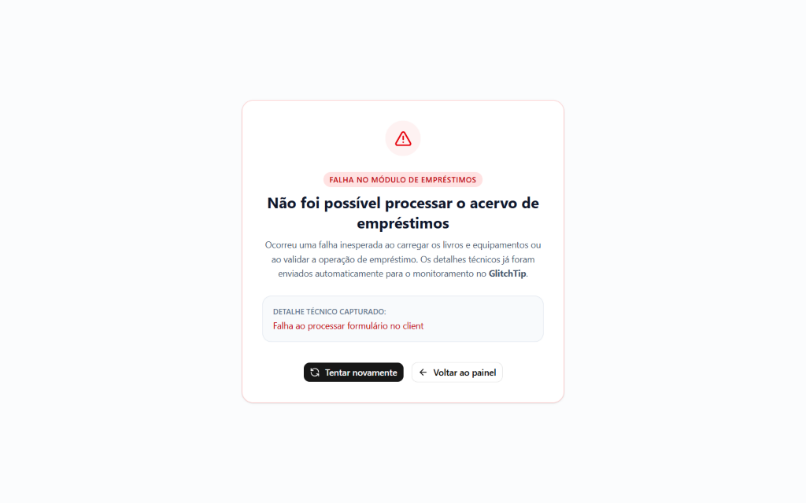
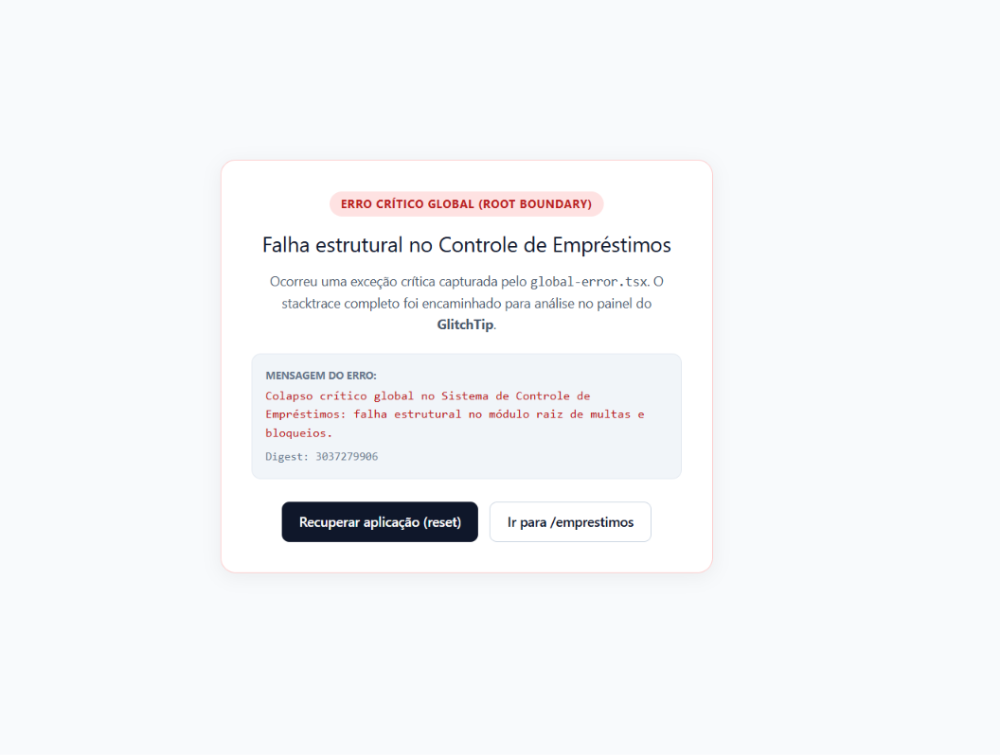
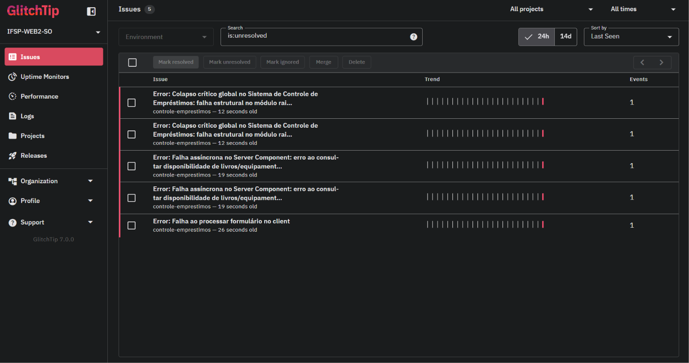
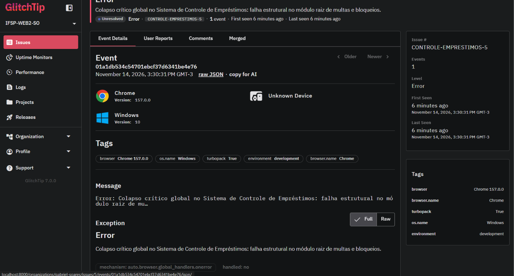

# Atividade 4 — Resiliência Visual e Monitoramento de Erros (Next.js + GlitchTip)

> **Disciplina:** Programação Web II (PPW II)  
> **Tema 08:** Controle de Empréstimo de Livros e Equipamentos Internos  
> **Aluno:** Gabriel Soares Pedrosa (`bi3041271`)

---

## 1. Arquitetura e Portas (Sem Conflito)

Para garantir a execução simultânea de toda a stack sem conflito de portas:
- **GlitchTip (Docker / WSL 2):** `http://localhost:8000`
- **Backend NestJS (`ppw_test_server`):** `http://localhost:8001`
- **Frontend Next.js (`ppw_test_client`):** `http://localhost:3000`

---

## 2. Subindo o GlitchTip via Docker (WSL 2 / Ubuntu)

O `infra/docker-compose.yml` utiliza a arquitetura unificada do **GlitchTip 7.0**, em que o serviço `web` (`./bin/start.sh`) centraliza o servidor HTTP, a fila de tarefas em segundo plano e as migrações de banco, acompanhado de **PostgreSQL** (`postgres:16-alpine`) e **Redis** (`redis:7-alpine`).

1. A partir da raiz do repositório, copie o `infra/docker-compose.yml` para uma pasta dentro do sistema de arquivos Linux no WSL 2 (ex: `~/projetos/glitchtip`):
   ```bash
   mkdir -p ~/projetos/glitchtip
   cp infra/docker-compose.yml ~/projetos/glitchtip/docker-compose.yml
   cd ~/projetos/glitchtip
   ```
2. Suba os containers (PostgreSQL, Redis e GlitchTip Web):
   ```bash
   docker compose up -d
   ```
3. Verifique o status dos serviços:
   ```bash
   docker compose ps
   ```
4. Acesse **`http://localhost:8000`**, crie sua conta de administrador, crie uma **Organization** e um **Project** com a plataforma **JavaScript / Next.js**, e copie a **DSN** gerada.

---

## 3. Configurando e Rodando a Aplicação Next.js e NestJS

### Backend (`ppw_test_server` — Porta 8001)
```bash
cd ppw_test_server
npm install
npx prisma generate
npm run start:dev
```

### Frontend (`ppw_test_client` — Porta 3000)
1. Configure o arquivo `.env.local` na pasta `ppw_test_client/` usando o `.env.example` como base:
   ```env
   NEXT_PUBLIC_SENTRY_DSN=http://SUA_CHAVE@localhost:8000/1
   SENTRY_DSN=http://SUA_CHAVE@localhost:8000/1
   NEXT_PUBLIC_API_URL=http://localhost:8001/emprestimos
   ```
2. Instale e execute:
   ```bash
   cd ppw_test_client
   npm install
   npm run dev
   ```

*(No Windows, você também pode dar dois cliques em `iniciar-servidores.bat` na raiz da `atv4` para iniciar o backend e o frontend automaticamente).*

---

## 4. Estrutura Implementada para Resiliência e Telemetria

- **Inicialização do SDK `@sentry/nextjs`:**
  - `ppw_test_client/src/instrumentation-client.ts` (Client-side)
  - `ppw_test_client/src/instrumentation.ts` + `sentry.server.config.ts` + `sentry.edge.config.ts` (Server / Edge)
- **Error Boundary de Rota (`ppw_test_client/src/app/emprestimos/error.tsx`):**
  - Client Component (`'use client'`) com interface contextualizada ao Tema 08, envio automático via `Sentry.captureException(error)` em `useEffect` e recuperação via `reset()`.
- **Error Boundary Global (`ppw_test_client/src/app/global-error.tsx`):**
  - Client Component raiz com tags `<html>` e `<body>` obrigatórias e captura fatal no GlitchTip.
- **Painel de Simulação de Falhas (`/emprestimos/testes-falha`):**
  1. **Disparador 01 (Client-side):** Força `throw new Error("Falha ao processar formulário no client")` para testar `error.tsx` e `reset()`.
  2. **Disparador 02 (Server Component / Assíncrono):** Simula falha de consulta ao PostgreSQL antes da renderização (`?erroServidor=true`).
  3. **Disparador 03 (Colapso Global):** Navega para `/simular-erro-global` acionando o `global-error.tsx`.
  4. **Disparador 04 (Telemetria Direta):** Envia evento customizado de erro de cálculo de multa progressiva com tags e metadados ao GlitchTip.

---

## 5. Evidências de Teste (`docs/`)

### Error Boundary de Rota (`error.tsx`) em ação


### Error Boundary Global (`global-error.tsx`) em ação


### Issues capturadas no painel do GlitchTip


### Detalhes do evento, tags e exceção no GlitchTip

